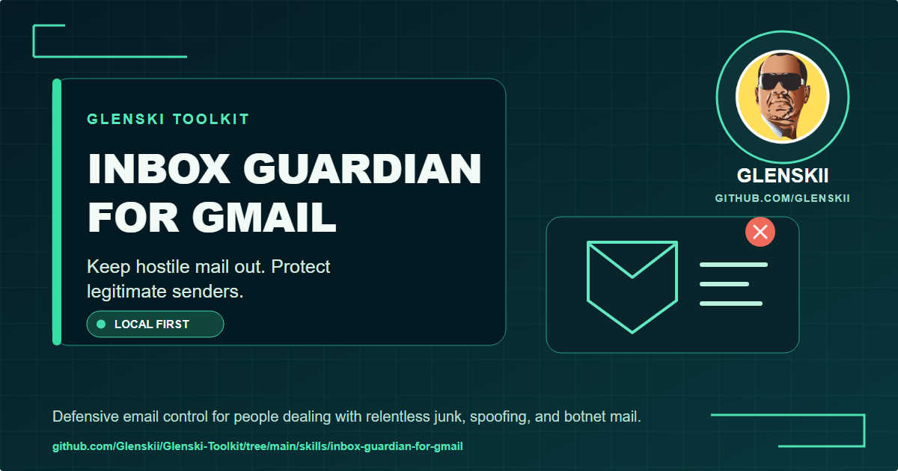
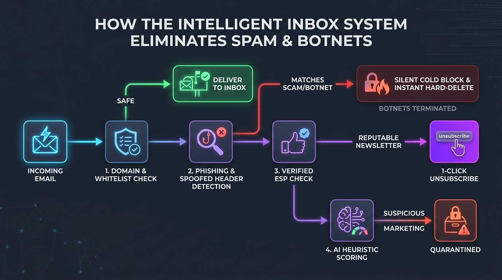

# Inbox Guardian for Gmail (v1.1.0)



> A Gmail spam and phishing filter that runs on your own computer. It holds suspicious mail for your review and never deletes anything from your inbox without your approval.
> It connects to Gmail through your own Google Cloud OAuth client.

[](https://opensource.org/licenses/MIT)
[](https://www.python.org/downloads/)
[]()

---

## How it works



---

## What it does

Inbox Guardian protects your Gmail inbox from spam botnets, fake account warnings and phishing. It puts your safety first: it never deletes email from your inbox without your approval.

1. **Holding folder.** It does not purge suspicious mail. It moves it into a folder named `Guardian/Review`. Messages held there never expire and are never deleted automatically. Review them when you like.
2. **Seven-day scan window.** Background sweeps only look at mail from the past seven days (`newer_than:7d`). It never scans older mailbox history.
3. **Shared sender protection.** Spammers often abuse big cloud email providers. Guardian will not harvest or block shared delivery networks: Amazon SES, SendGrid, Mailgun, Postmark, Mailchimp, Microsoft, Google, Meta and Resend.
4. **Relay defense.** When a message in your trash is confirmed as a botnet attack, Guardian traces the hidden return path and finds the real root server domain, such as a rogue `.biz` or `.web.id` farm. It then blocks that whole network permanently.
5. **Two-way training.** Move good mail from the review folder back to your inbox and Guardian learns to trust that sender. Confirm a message is junk and it learns the pattern.
6. **Dashboard.** A browser page shows live status and active whitelist badges. It refreshes every fifteen seconds without reloading.
7. **Least privilege.** The default Gmail setup reads headers, applies labels and moves messages. It does not give Guardian administrative access to your account.
8. **Windows background service.** Windows Task Scheduler can run a sweep every fifteen minutes. It runs quietly, with no console windows and no stolen focus.

---

## Requirements

- Python 3.9 or higher
- A personal Gmail or Google Workspace account
- A free Google Cloud OAuth client credentials file (`credentials.json`)

---

## Installation and setup

### 1. Download and install

#### macOS and Linux
```bash
git clone https://github.com/Glenskii/Glenski-Toolkit.git
cd Glenski-Toolkit/skills/inbox-guardian-for-gmail
python3 -m venv .venv
source .venv/bin/activate
pip install -r requirements.txt
pip install -r requirements-dev.txt
cp config.example.json config.json
```

#### Windows (PowerShell)
```powershell
git clone https://github.com/Glenskii/Glenski-Toolkit.git
cd Glenski-Toolkit\skills\inbox-guardian-for-gmail
python -m venv .venv
.\.venv\Scripts\Activate.ps1
pip install -r requirements.txt
pip install -r requirements-dev.txt
copy config.example.json config.json
```

---

### 2. Google Cloud setup

Follow the [Google OAuth setup guide](docs/google-oauth-setup.md). Save the Desktop app client file you download beside `guardian.py` as `credentials.json`, then run:

```bash
python guardian.py --setup
```

Setup initializes your configuration, opens your default browser for Google consent, stores your token with private permissions and confirms the mailbox connection.

---

## Using it

### 1. Check the connection and account
Confirm your OAuth credentials are valid and show the active account:
```bash
python guardian.py --setup
```

### 2. Open the dashboard
Generate the live status report and open it in your browser:
```bash
python guardian.py --dashboard
```

### 3. Index your trusted contacts
Scan your Sent and Starred messages to build your local VIP reputation database:
```bash
python guardian.py --seed-reputation
```

### 4. Print a 24-hour summary
Show recent activity in your terminal:
```bash
python guardian.py --summary
```

### 5. Run an inbox audit (dry run)
Inspect recent mail, review the classifications and write a review file:
```bash
python guardian.py
```
This writes an audit file named `guardian_review_YYYYMMDD_HHMMSS.json`.

### 6. Quarantine from a review file
Move the audited candidates to your `Guardian/Review` holding folder:
```bash
python guardian.py --execute --review-file guardian_review_20260826_080000.json
```

### 7. Move flagged items to Trash
To send audited items straight to your standard Trash instead:
```bash
python guardian.py --execute --review-file guardian_review_20260826_080000.json --trash
```

### 8. Review unsubscribe headers
Inspect incoming messages that carry RFC unsubscribe headers:
```bash
python guardian.py --review-unsub
```

---

## Windows background service

After setup, Windows Task Scheduler can run Guardian silently. The service defaults to safe quarantine in your `Guardian/Review` folder, keeps your dashboard current and respects the shared sender protection.

Read the [Windows background-service guide](docs/windows-background-service.md) before you install the task. For a manual audit schedule on any platform, see the [scheduled audit guide](docs/scheduled-runs.md).

---

## Running tests

To check that the safety rules and functions pass:
```bash
pytest tests/ -v
```

---

## Local data and privacy

Guardian keeps its OAuth token, configuration, review files, SQLite reputation database and activity history on your machine, beside the skill. Git ignores these private files, and you must not publish them. The only outside connection is the official Google Gmail API, through your own credentials. See [SECURITY.md](SECURITY.md) and the [safety model](docs/safety-model.md).

---

## License

Released under the [MIT License](LICENSE). Copyright (c) 2026 Glen E. Grant.
