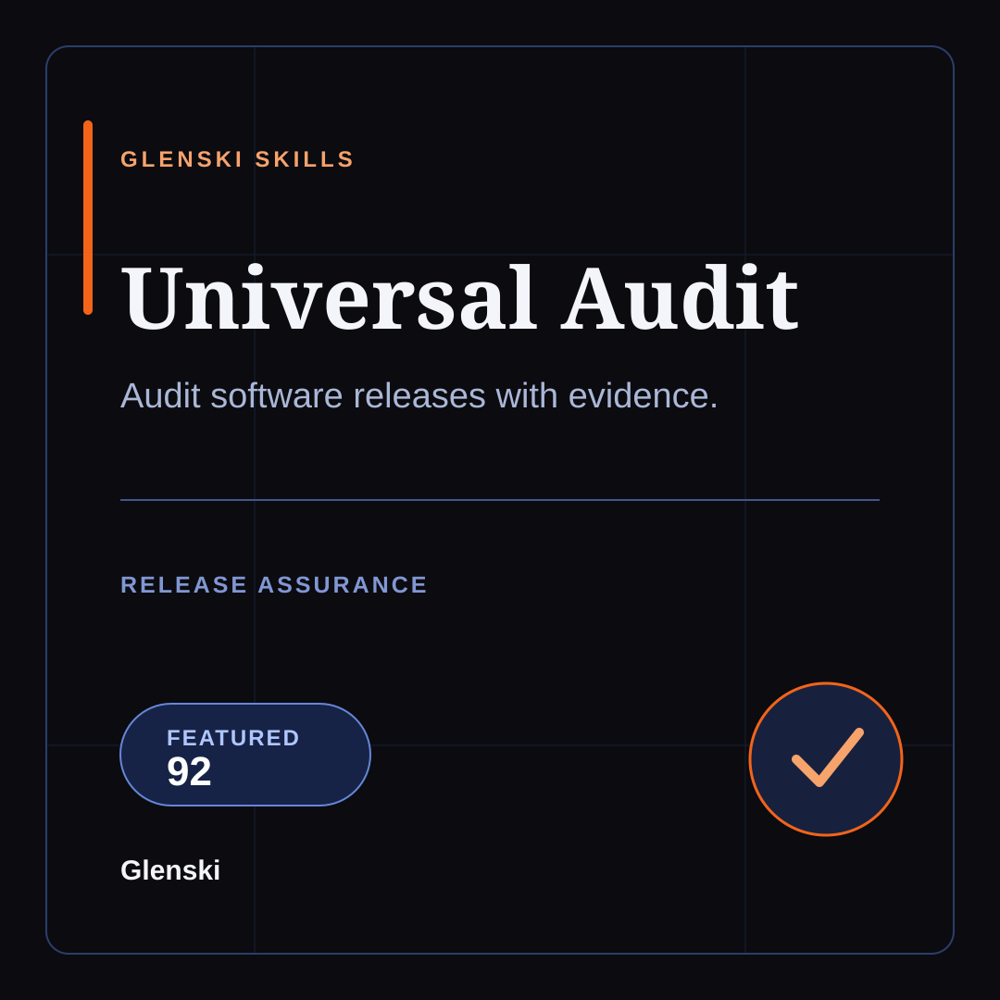

# universal-audit

A full software audit that ends in a decision: ship it, ship it with conditions, fix it first, or don't ship. Every conclusion points at evidence, and a good score can't talk its way past a failed release gate.



It follows the Universal Software Engineering Audit Specification v2.2, which covers product fit, security, architecture, data, supply chain, reliability, recovery, performance, quality, accessibility, UX, privacy, AI features and decommissioning.

## What you get

One run produces a readable report and the records behind it:

```text
audits/AUD-MYAPP-20260710-001/
  audit-manifest.json      who, what, scope, authorization, version
  selected-controls.json   the controls in scope, frozen before evidence is gathered
  evidence-ledger.json     every observation, sanitized
  findings.json            the findings, one record each
  rejected-claims.json     concerns that were checked and disproved, never scored
  score-sheet.json         scores, caps, coverage and gate results
  risk-register.json
  verification-log.json    the independent challenge of each serious finding
  report.md                the deliverable
```

The verdict is one of APPROVED, APPROVED WITH CONDITIONS, REQUIRES REWORK or DO NOT SHIP. The release gates pick it. The score never does.

## How it behaves

- **A pass needs evidence.** A scanner staying quiet is not a pass. Anything it couldn't verify is marked UNVERIFIED and says what would verify it.
- **Coverage is stated honestly.** A quick audit reports its coverage against the standard audit too, so a shallow pass can't pass for a deep one.
- **Serious findings get challenged.** A separate pass tries to knock down every high-severity finding before the report goes out.
- **Read-only by default.** It inspects, it doesn't test or change anything unless written rules of engagement say it may.

## Security hunt

Checking that a defense exists is not the same as looking for the hole nobody listed. For source code, the skill bundles a hunting protocol (Cloudflare's security-audit, MIT, in `vendor/security-audit/`) and imports what it finds:

- confirmed vulnerabilities become failed findings with a severity
- leads that need a fact from outside the code become UNVERIFIED, with no severity
- claims that were tested and disproved are kept in `rejected-claims.json`

The hunt doesn't replace the independent challenge. Every critical or high finding still goes through it. Without a sandbox, which is the usual case on Windows, the hunt reads source only and returns anything that needs execution as unverified. See `references/security-hunt-integration.md`.

## Scripts

Python standard library only. Run them with `python -I`.

| Script | What it does |
| --- | --- |
| `scripts/init_audit_artifacts.py` | Creates a new audit folder without overwriting an old one |
| `scripts/score.py` | Scores the controls, applies caps and checks the release gates |
| `scripts/import-security-hunt.py` | Brings a hunt run into the audit folder, safe to run twice |
| `scripts/validate-audit-artifacts.py` | Checks the records agree with each other. `--release` also requires every high finding to have been challenged |
| `scripts/reaudit-diff.py` | Tells you which earlier findings still apply, by comparing the source between two commits |

```bash
python -I scripts/score.py audits/<id>/selected-controls.json \
    --profile P4 --tier standard --out audits/<id>/score-sheet.json
```

## Layout

```text
universal-audit/
  SKILL.md        the procedure the agent follows
  spec/           the v2.2 specification
  references/     tier and profile guide, check procedures, templates, schemas
  scripts/        scoring, import, validation, re-audit
  vendor/         the bundled security hunt protocol
```

## Use it

Copy the `universal-audit` folder into your agent's skills directory, then ask for a "full audit", "release audit" or "formal audit with a verdict" on a project. For a quick cleanup pass, use something lighter. This is the heavy option on purpose.

## License

MIT. See [LICENSE](LICENSE). The bundled security hunt keeps its own MIT notice in `vendor/security-audit/LICENSE`.
